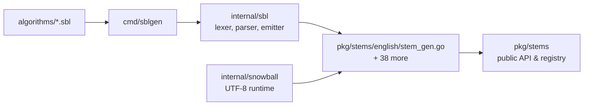

<p align="center">
  
</p>

<h1 align="center">stems</h1>

<p align="center">
  <strong>All 39 official <a href="https://snowballstem.org/">Snowball</a> stemming algorithms &mdash; pure Go, zero runtime dependencies.</strong>
</p>

<p align="center">
  <a href="https://pkg.go.dev/github.com/cafecito-games/stems"></a>
  <a href="https://github.com/cafecito-games/stems/actions/workflows/ci.yml"></a>
  <a href="https://goreportcard.com/report/github.com/cafecito-games/stems"></a>
  <a href="go.mod"></a>
  <a href="LICENSE"></a>
  <br>
  
  
  
</p>

---

`stems` reduces words to their root form for search indexing, text classification, and NLP pipelines. It ships its own Snowball-to-Go compiler (`cmd/sblgen`), so every stemmer is generated from the upstream `.sbl` specification rather than ported by hand — and every one is verified against the official Snowball vocabularies, **11,707,009 word pairs with zero mismatches**.

- **39 languages**, each also available as a standalone subpackage with no dispatch overhead.
- **Zero runtime dependencies** — the only module requirement is `testify`, used in tests.
- **Goroutine-safe** stemmers; share one across your whole service.
- **Typed language selection** with `ParseLanguage` over English names, native names, and ISO 639-1/639-2 codes.
- **Official stop word lists** for 17 languages, with opt-in stop-word skipping.
- **`iter.Seq` streaming** via `StemSeq`, plus a CLI for pipelines and shell work.
- Built for **Go 1.26** on a UTF-8 Snowball runtime: short words stem in a stack buffer, and a stem that is just a prefix of the input is returned without copying it.

## Installation

```sh
go get github.com/cafecito-games/stems
```

## Usage

### Stem a single word

```go
package main

import (
	"fmt"
	"log"

	"github.com/cafecito-games/stems/pkg/stems"
)

func main() {
	stemmed, err := stems.Stem("Accumulations", stems.English)
	if err != nil {
		log.Fatal(err)
	}
	fmt.Println(stemmed) // Output: accumul
}
```

### Reusable stemmer with stop-word skipping and `iter.Seq`

```go
package main

import (
	"fmt"
	"log"
	"slices"

	"github.com/cafecito-games/stems/pkg/stems"
)

func main() {
	language, err := stems.ParseLanguage("es")
	if err != nil {
		log.Fatal(err)
	}

	stemmer, err := stems.New(language, stems.WithSkipStopWords())
	if err != nil {
		log.Fatal(err)
	}

	words := []string{"preocuparse", "porque", "oposición"}
	stemmed := slices.Collect(stems.StemSeq(stemmer, slices.Values(words)))
	fmt.Println(stemmed)
}
```

### Direct language subpackages

If you only need a single language, import its generated package directly:

```go
import "github.com/cafecito-games/stems/pkg/stems/english"

stem := english.Stem("running")         // "run"
isStop := english.IsStopWord("because") // true
```

## Supported languages

Every language is verified against the official Snowball vocabulary for that algorithm.

| Language | Constant | Package | Stop words | Vocabulary verified |
| --- | --- | --- | :---: | ---: |
| Arabic | `stems.Arabic` | `pkg/stems/arabic` | — | 9,196,214 |
| Armenian | `stems.Armenian` | `pkg/stems/armenian` | — | 101,780 |
| Basque | `stems.Basque` | `pkg/stems/basque` | — | 21,386 |
| Catalan | `stems.Catalan` | `pkg/stems/catalan` | — | 48,897 |
| Czech | `stems.Czech` | `pkg/stems/czech` | — | 58,137 |
| Danish | `stems.Danish` | `pkg/stems/danish` | ✓ | 23,868 |
| Dutch | `stems.Dutch` | `pkg/stems/dutch` | ✓ | 45,670 |
| Dutch (Porter) | `stems.DutchPorter` | `pkg/stems/dutchporter` | — | 45,670 |
| Early Modern English | `stems.EarlyModernEnglish` | `pkg/stems/earlymodernenglish` | — | 36,534 |
| English (Porter2) | `stems.English` | `pkg/stems/english` | ✓ | 42,649 |
| Esperanto | `stems.Esperanto` | `pkg/stems/esperanto` | — | 84,456 |
| Estonian | `stems.Estonian` | `pkg/stems/estonian` | — | 57,537 |
| Finnish | `stems.Finnish` | `pkg/stems/finnish` | ✓ | 84,399 |
| French | `stems.French` | `pkg/stems/french` | ✓ | 21,653 |
| German | `stems.German` | `pkg/stems/german` | ✓ | 35,053 |
| Greek | `stems.Greek` | `pkg/stems/greek` | — | 90,727 |
| Hindi | `stems.Hindi` | `pkg/stems/hindi` | — | 65,118 |
| Hungarian | `stems.Hungarian` | `pkg/stems/hungarian` | ✓ | 29,881 |
| Indonesian | `stems.Indonesian` | `pkg/stems/indonesian` | ✓ | 64,586 |
| Irish | `stems.Irish` | `pkg/stems/irish` | ✓ | 186,280 |
| Italian | `stems.Italian` | `pkg/stems/italian` | ✓ | 37,426 |
| Lithuanian | `stems.Lithuanian` | `pkg/stems/lithuanian` | — | 86,109 |
| Lovins | `stems.Lovins` | `pkg/stems/lovins` | — | 42,603 |
| Nepali | `stems.Nepali` | `pkg/stems/nepali` | — | 4,000 |
| Norwegian (Bokmål) | `stems.Norwegian` | `pkg/stems/norwegian` | ✓ | 20,913 |
| Persian | `stems.Persian` | `pkg/stems/persian` | — | 104,268 |
| Polish | `stems.Polish` | `pkg/stems/polish` | — | 62,576 |
| Porter | `stems.Porter` | `pkg/stems/porter` | — | 42,603 |
| Portuguese | `stems.Portuguese` | `pkg/stems/portuguese` | ✓ | 32,016 |
| Romanian | `stems.Romanian` | `pkg/stems/romanian` | — | 87,642 |
| Russian | `stems.Russian` | `pkg/stems/russian` | ✓ | 49,785 |
| Serbian | `stems.Serbian` | `pkg/stems/serbian` | — | 29,996 |
| Sesotho | `stems.Sesotho` | `pkg/stems/sesotho` | ✓ | 9,848 |
| Spanish | `stems.Spanish` | `pkg/stems/spanish` | ✓ | 28,378 |
| Swedish | `stems.Swedish` | `pkg/stems/swedish` | ✓ | 30,738 |
| Tamil | `stems.Tamil` | `pkg/stems/tamil` | — | 443,271 |
| Turkish | `stems.Turkish` | `pkg/stems/turkish` | — | 96,325 |
| Ukrainian | `stems.Ukrainian` | `pkg/stems/ukrainian` | ✓ | 58,021 |
| Yiddish | `stems.Yiddish` | `pkg/stems/yiddish` | — | 99,996 |

## CLI

Install or run the included command-line tool to stem newline-delimited words from a file or `stdin`:

```sh
go install github.com/cafecito-games/stems/cmd/stems@latest

# Stem from stdin
printf "Accumulations\nrunning\nbecause\n" | stems -language en -skip-stop-words

# Stem from a file
stems -language spanish -input words.txt

# List all 39 supported languages
stems -list-languages
```

## How it works

Snowball `.sbl` specifications are the single source of truth. Nothing in `pkg/stems/<language>/` is written by hand.



The compiler lowers each Snowball routine to a Go method, hoists `among(...)` tables into package-level lookup tables, and compiles character classes into dense bitsets. The runtime (`internal/snowball`) is a UTF-8 cursor over a mutable byte buffer, so stemming never decodes a word into runes.

### Project layout

```text
algorithms/         Upstream Snowball .sbl specs and official stop word lists
cmd/
├── sblgen/         Snowball-to-Go code generator invoked via `go generate ./...`
└── stems/          Command-line stemming utility
internal/
├── sbl/            Snowball lexer, parser, AST, and Go 1.26 code emitter
├── snowball/       UTF-8 Snowball runtime environment (cursor, groupings, among matcher)
└── testutil/       Streaming vocabulary verification and benchmark helpers
pkg/
└── stems/          Public Go API, generated registry, and 39 language packages
testdata/           Compressed official Snowball vocabularies (tracked with Git LFS)
```

## Development

Workflows are orchestrated via [Taskfile.yml](Taskfile.yml); run `task` to list them. Compressed test vocabularies in `testdata/*.tsv.gz` are tracked with Git LFS — run `git lfs pull` after cloning if the objects were not fetched automatically.

| Command | What it does |
| --- | --- |
| `task check` | Full local verification: generate, fmt, headers, vet, lint, test, build |
| `task generate` | Regenerate all 39 language packages and the registry from `algorithms/*.sbl` |
| `task test` | Race-enabled tests, sampling corpora over 200,000 words |
| `task test:full` | Verify all 39 languages against all 11,707,009 official vocabulary pairs |
| `task bench` | Comparative benchmarks across all languages and API modes |
| `task bench:all` | Per-package corpus benchmarks for all 39 language packages |
| `task fmt` / `task lint` | Format and lint with `golangci-lint` |

Fuzzing a single language:

```sh
go test -fuzz=FuzzStem -fuzztime=10s ./pkg/stems/english
```

## Contributing

Adding a language, updating an algorithm, or improving the compiler? See [CONTRIBUTING.md](CONTRIBUTING.md).

## License

`stems` is released under the [MIT License](LICENSE), mascot included. Upstream Snowball algorithm sources in `algorithms/` are BSD 3-Clause, and test vocabularies in `testdata/` carry their respective attributions in [testdata/LICENSE](testdata/LICENSE).
